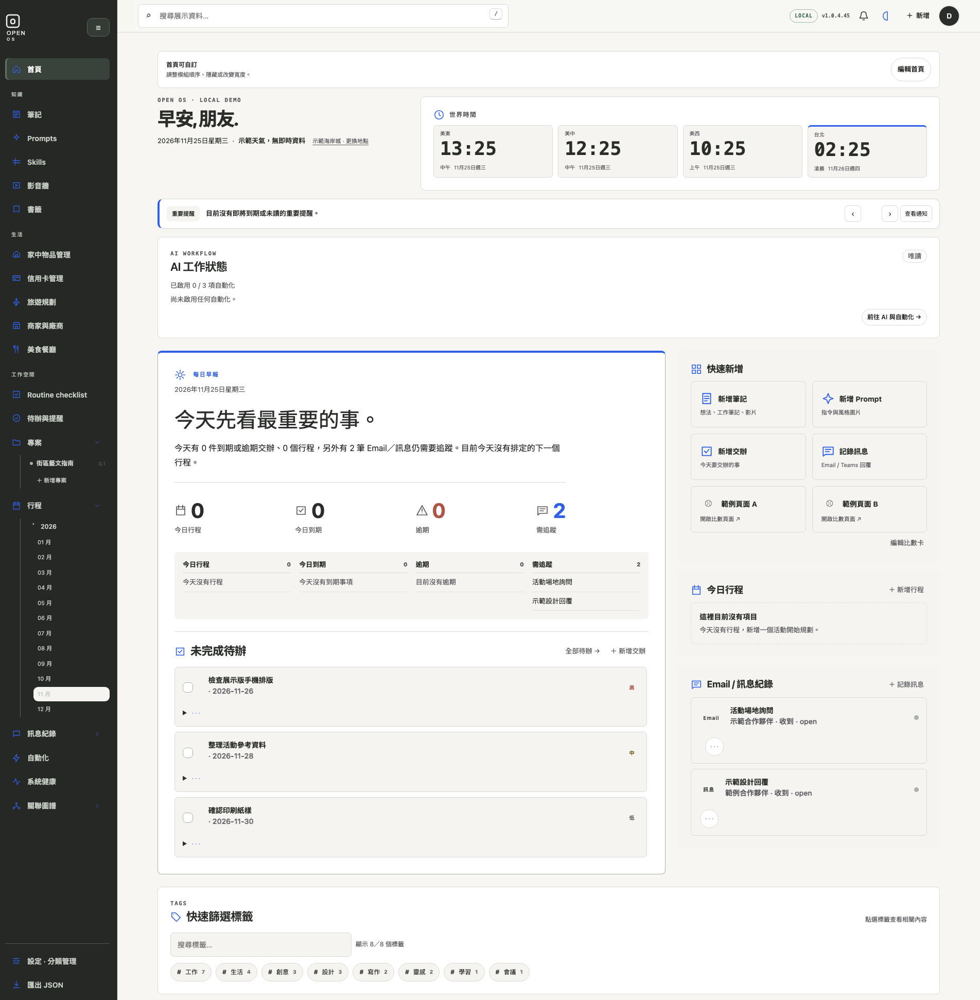
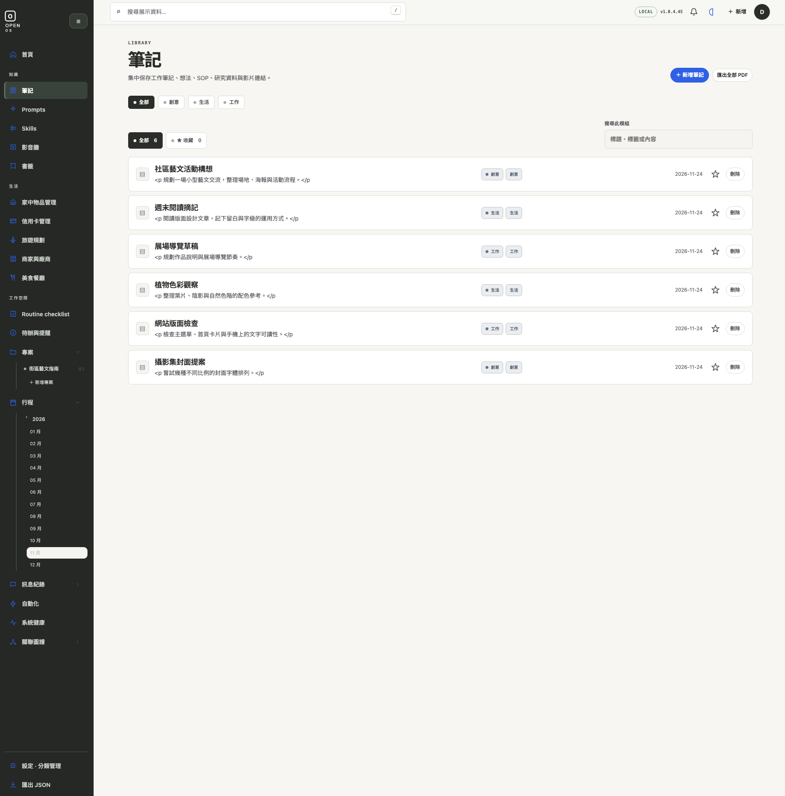
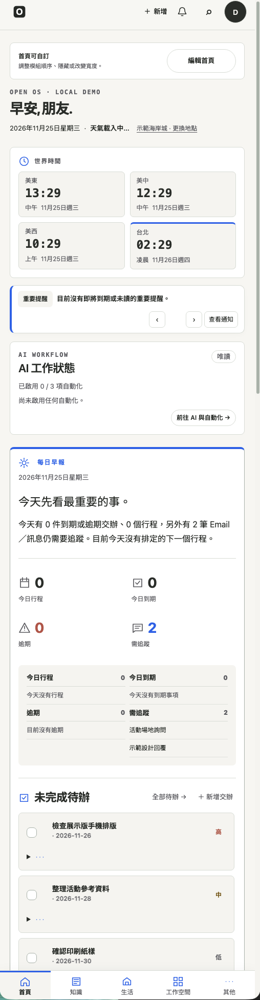

# OPEN OS Public Mirror

Current release: v1.0.4.45.

這是以 IAN OS v1.0.4.45 COMPLETE 原始碼製作的公開範例副本。**頁面版型、導覽、模組和主要互動沿用原版**；OPEN OS 標誌是重新繪製的。範例內容為虛構資料，不包含原作者的個人紀錄、連結、照片、帳號或正式環境設定。

## 啟動

```sh
python3 -m http.server 8080 -d site
```

在瀏覽器開啟 `http://localhost:8080/`。請使用獨立網域或 GitHub Pages 路徑，不要將公開展示版覆蓋在正式 IAN OS 網址上。`site/` 是可部署的靜態網站；原始碼、文件與測試可一併放在 GitHub。

## 資料與功能

- 首次啟動自動載入 `site/js/data.js` 的虛構示範內容，無須登入。
- 原版資料存取介面改由 `site/js/demo-store.js` 對接瀏覽器 localStorage。餐廳、家中物品及主要工作區紀錄也儲存在本機。不同瀏覽器和裝置之間不會同步，清除網站資料後範例會恢復初始值。
- 原版的 Supabase SDK、設定檔、Edge Functions、SQL migration 與 Gmail 帳號連接均未包含。郵件、背景排程、雲端同步與其他需要伺服器的能力不會連接或執行。
- 世界時間仍依瀏覽器時區計算。天氣以「示範天氣，無即時資料」呈現。外部公開參考網址是可選連結，使用者需主動開啟。
- 小型圖片以本機資料 URL 儲存；受 localStorage 配額限制，這是公開展示用途，不能取代雲端檔案儲存。

## 修改範例

- `site/js/data.js`：預設內容。
- `site/js/home-quick-links-data.js`：首頁範例連結。
- `site/js/demo-store.js`：本機資料儲存。
- `site/assets/brand/`：OPEN OS 示範標誌與 PWA 圖示。
- 其他版面與模組仍沿用原始 vanilla JavaScript 與 CSS。修改後執行 `node tools/stamp-assets.cjs` 更新檔案雜湊。

此範例與正式環境分離，請勿把正式資料或 API 金鑰放進公開倉庫。MIT 授權見 `LICENSE`，隨附的第三方程式庫以各自的授權條款為準。

## 公開發布

公開前請檢查 `QA.md` 與 `THIRD-PARTY.md`。本包沒有正式資料庫連線，但尚未通過實機瀏覽器畫面與完整互動測試。GitHub Pages 不處理 `.htaccess`；如需部署 CSP HTTP 標頭，請在託管平台另行設定。

## 畫面預覽



